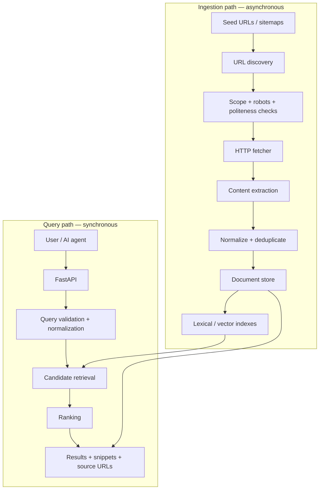

# 01 — System Architecture

## 1. What are we building?

We are building a self-hosted search service over a corpus of web pages that we are allowed to crawl or that the operator explicitly supplies.

A search engine has two major paths:

- **Offline / ingestion path:** discover URLs, fetch pages, extract content, normalize it, and build indexes.
- **Online / query path:** accept a query, retrieve candidate documents, rank them, and return useful results with provenance.

Keeping these paths separate is important. A user search request should not normally trigger an uncontrolled crawl of the whole internet.

## 2. High-level architecture

## 3. Component responsibilities

| Component | Responsibility | Important design concern |
|---|---|---|
| URL discovery | Finds candidate URLs from seeds, sitemaps, and permitted links | Prevent crawl traps and unbounded growth |
| Scope and policy | Decides whether a URL may be fetched | Domain allowlist, robots.txt, SSRF protection |
| Fetcher | Downloads HTML with HTTP | Timeouts, size limits, redirects, retries |
| Extractor | Removes navigation and boilerplate | Preserve title, canonical URL, main text |
| Normalizer | Cleans and standardizes content | Stable URL normalization and deduplication |
| Document store | Persists page metadata and extracted text | Provenance and recrawl history |
| Indexer | Builds searchable fields and embeddings | Rebuildability and idempotency |
| Retriever | Finds candidate pages for a query | Recall, latency, filtering |
| Ranker | Orders candidates by usefulness | Relevance, freshness, quality signals |
| API | Exposes search and administration operations | Validation, auth for crawl operations, limits |

## 4. Data flow: indexing a page

1. An operator submits a seed URL or sitemap.
2. The discovery component parses candidate links.
3. The policy component checks scheme, host scope, robots rules, and network safety.
4. The fetcher retrieves the page using bounded network settings.
5. The extractor identifies the title, canonical URL, description, and main text.
6. The normalizer removes irrelevant whitespace and computes content hashes.
7. The document store saves the page and crawl metadata.
8. The indexer updates lexical fields and, later, vector embeddings.

A failed page should have a recorded crawl outcome. It should not silently disappear or corrupt a previously indexed good version.

## 5. Data flow: answering a search query

1. The client calls `POST /api/v1/search`.
2. FastAPI validates the query, limit, and optional filters.
3. The query processor normalizes the text without destroying meaningful terms.
4. The retriever finds candidate documents using PostgreSQL full-text search.
5. The ranker sorts candidates.
6. The API returns title, URL, snippet, score, and retrieval metadata.
7. An AI agent may fetch selected page content through a separate endpoint or tool.
8. The LLM writes an answer and attributes claims to the returned sources.

The search API should return evidence, not pretend that its relevance score is a probability of truth.

## 6. Why start with lexical search?

Start with PostgreSQL full-text search before adding embeddings.

Lexical search gives us a transparent baseline:
- Exact technical terms and identifiers can match well.
- There is no embedding model to operate.
- Indexing and ranking are easier to inspect.
- It creates a benchmark for later semantic and hybrid approaches.

Semantic search is valuable for meaning-based matches, but it can miss exact identifiers, version numbers, error codes, and uncommon names. Hybrid retrieval combines complementary signals.

## 7. Suggested API boundaries

Initial public query API:

- `POST /api/v1/search` — search indexed pages.
- `GET /api/v1/pages/{page_id}` — retrieve stored page metadata/content, subject to response limits.
- `GET /health/live` — process liveness.
- `GET /health/ready` — database and dependency readiness.

Restricted ingestion/admin API:

- `POST /api/v1/crawl/jobs` — submit a bounded crawl job.
- `GET /api/v1/crawl/jobs/{job_id}` — inspect job status.

Do not expose arbitrary URL fetching as an unauthenticated public endpoint. That can become an SSRF proxy.

## 8. Initial deployment topology

For local development:

- FastAPI application container.
- PostgreSQL with pgvector extension available.
- A worker process for crawl and indexing jobs.
- Ollama running on the host initially, if used for local embeddings.

The API process should not perform long-running crawls inside a request handler. A job queue or database-backed worker can execute those tasks independently.

## 9. Non-functional requirements

### Safety and scope
- Crawl only configured domains or explicitly submitted URLs.
- Respect robots.txt and site terms.
- Use per-host concurrency and delay limits.
- Reject localhost, private, link-local, and reserved IP destinations, including after DNS resolution and redirects.
- Limit redirects, response bytes, content types, and total crawl depth.
- Never bypass authentication, paywalls, CAPTCHAs, or access controls.

### Reliability
- Make crawl jobs resumable.
- Make page upserts and indexing idempotent.
- Use retries with exponential backoff and jitter for transient errors.
- Preserve the last successful page version when a recrawl fails.
- Record structured errors and crawl timestamps.

### Observability
- Log request IDs, crawl job IDs, host, status, duration, and outcome.
- Track fetch success rate, extraction failures, queue depth, indexed page count, and search latency.
- Avoid logging secrets or full sensitive page bodies.

### Performance
- Paginate or cap result counts.
- Add database indexes based on measured query plans.
- Cache only when freshness semantics are clear.
- Measure p50, p95, and p99 latency rather than relying on intuition.

## 10. Architecture decisions for the first milestone

| Decision | Initial choice | Reason |
|---|---|---|
| Corpus | Explicit allowlisted domains and seed URLs | Safe and manageable |
| Fetching | httpx | Async-capable HTTP client |
| Extraction | Trafilatura, with BeautifulSoup for parsing/discovery | Main-content extraction plus HTML utilities |
| Storage | PostgreSQL | Metadata, content, and full-text search in one system |
| Lexical retrieval | PostgreSQL FTS | Strong baseline with low operational complexity |
| Semantic retrieval | Add pgvector later | Avoid premature complexity |
| Background work | Separate worker process | Keep API requests short |
| LLM | Ollama, optional | Local inference; not required for core search |

## 11. Milestone acceptance criteria

The architecture milestone is complete when you can explain:

- Why crawling and querying are separate workflows.
- How a URL becomes an indexed document.
- How a search request becomes ranked results.
- Why the API must not fetch arbitrary URLs on demand.
- Why lexical search is the first retrieval baseline.
- Which safeguards prevent crawler abuse and SSRF.

## 12. Next document

Read [Search Engine Fundamentals](02-search-engine-fundamentals.md) next. It explains crawling, indexing, retrieval, ranking, and the difference between a crawler, search engine, and web-search API.
