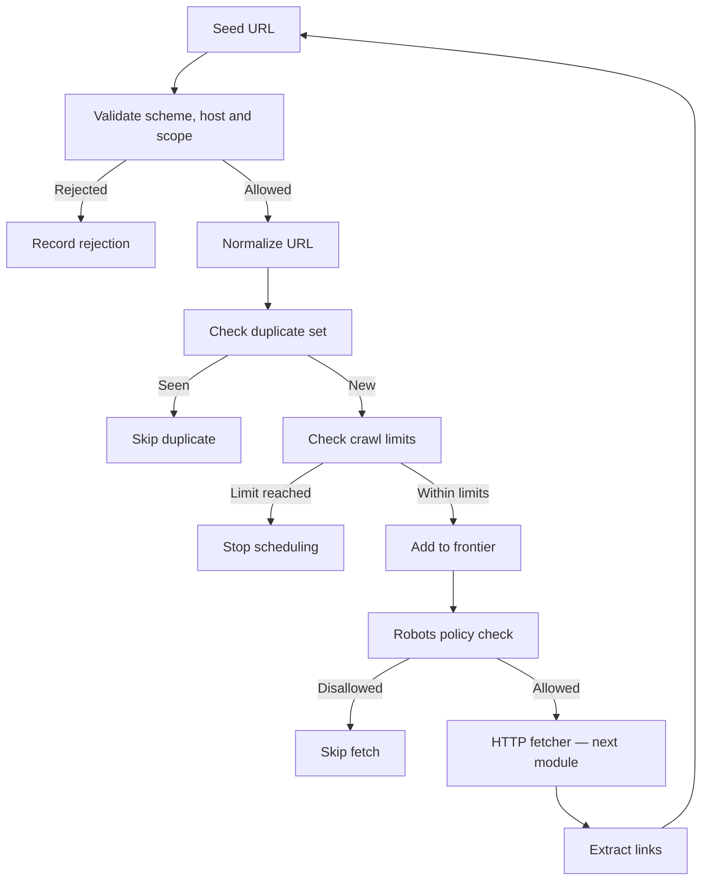

# 03 — Web Crawling: Safe Foundations

## 1. What this module builds

A crawler discovers URLs and schedules permitted pages for fetching. It must not behave like an unrestricted URL downloader.

This module implements four foundations:

1. URL validation and domain allowlisting.
2. URL normalization.
3. A bounded breadth-first crawl frontier.
4. Robots.txt policy evaluation.

The next module will add the HTTP fetcher, DNS/IP checks at connection time, timeouts, redirect validation, response-size limits, and per-host rate limiting.

## 2. Crawler lifecycle



## 3. URL validation

Never assume a URL is safe because it came from a web page. A page can contain links to localhost, private IP addresses, cloud metadata endpoints, or unrelated domains.

The initial policy in `app/crawler/url_policy.py`:

- Accepts only HTTP and HTTPS.
- Rejects missing hosts and embedded credentials.
- Rejects IP-literal hosts and local/reserved hostnames.
- Allows only explicitly configured domains and their subdomains.
- Allows only standard HTTP/HTTPS ports.
- Removes fragments because fragments are not sent to the server.
- Normalizes scheme and hostname casing and removes default ports.

Domain matching must be boundary-aware. If `example.com` is allowed, `docs.example.com` is in scope, but `notexample.com` and `example.com.attacker.test` are not.

### Important limitation

A hostname can resolve to a private IP address even when the URL itself looks public. URL string validation alone cannot prevent DNS rebinding or unsafe redirects. The actual fetcher must resolve and validate every destination IP, re-check after redirects, and connect safely. That is why the current module does not make network requests.

## 4. URL normalization

Normalization helps identify equivalent URLs and avoid repeated work.

Examples:
- `HTTPS://DOCS.EXAMPLE.COM/guide#install` becomes `https://docs.example.com/guide`.
- `https://docs.example.com:443/guide` becomes `https://docs.example.com/guide`.

Do not blindly remove all query parameters or reorder them. Query parameters can change page content. Later, we can add a configurable tracking-parameter policy after observing real sites.

## 5. The crawl frontier

The frontier is the collection of URLs waiting to be processed. The implementation uses a FIFO queue, producing breadth-first traversal.

Each queued item contains:
- Normalized URL.
- Crawl depth.
- Parent URL that discovered it.

The frontier enforces:
- Maximum number of scheduled pages.
- Maximum crawl depth.
- Duplicate suppression.
- Scope validation before enqueueing.

For the first version, the queue is in memory. This is simple and testable, but queued work is lost if the process stops. A later persistence module will move frontier state into PostgreSQL or a dedicated queue.

## 6. Robots.txt

A robots.txt file communicates crawler rules for user agents and URL paths.

The implementation parses robots.txt content and asks whether our configured user-agent may fetch a URL. The crawler must fetch robots.txt itself through the same safe networking layer as other URLs.

Robots.txt is not a substitute for:
- Site terms and permission.
- Authentication and access controls.
- Rate limits and politeness.
- Copyright and privacy obligations.

If robots.txt cannot be fetched, production policy must be explicit. A conservative crawler should fail closed for that host until the operator decides how to proceed, rather than silently assuming everything is allowed.

## 7. Running the tests

From the repository root:

```bash
python3.12 -m venv .venv
source .venv/bin/activate
python -m pip install --upgrade pip
python -m pip install pytest
python -m pytest -q
```

The tests in `tests/test_crawler_foundations.py` cover:
- Allowed and disallowed domains.
- Subdomain boundary matching.
- Unsupported schemes, credentials, IP literals, and unsafe ports.
- URL normalization.
- Duplicate suppression.
- Depth and page-count limits.
- Robots.txt allow and disallow rules.

## 8. Example usage

```python
from app.crawler.frontier import CrawlFrontier
from app.crawler.url_policy import URLPolicy

policy = URLPolicy(allowed_domains={"python.org"})
frontier = CrawlFrontier(policy=policy, max_pages=100, max_depth=2)

frontier.add("https://www.python.org/", depth=0, parent_url=None)
frontier.add(
    "https://docs.python.org/3/library/asyncio.html",
    depth=1,
    parent_url="https://www.python.org/",
)

while item := frontier.pop():
    print(item.url, item.depth, item.parent_url)
```

This example schedules URLs only. It deliberately does not fetch them.

## 9. Production concerns before enabling network access

The next HTTP-fetching layer must implement all of these:

1. Resolve DNS and reject loopback, private, link-local, multicast, reserved, and unspecified addresses.
2. Defend against DNS rebinding by ensuring the validated destination is the destination actually connected to.
3. Revalidate every redirect target and enforce a small redirect limit.
4. Use connect, read, and total timeouts.
5. Limit response bytes while streaming; do not trust Content-Length alone.
6. Accept only configured content types, initially HTML.
7. Enforce per-host concurrency and request delays.
8. Identify the crawler with a descriptive User-Agent and contact/policy URL where appropriate.
9. Record status, duration, fetched time, and failure reason.
10. Keep crawl endpoints authenticated and rate-limited.

Never use the crawler as a proxy to fetch arbitrary URLs supplied by unauthenticated users.

## 10. Design exercise

Before moving on, make sure you can answer:

1. Why is `example.com.evil.test` not a subdomain of `example.com`?
2. Why is URL validation not enough to prevent SSRF?
3. Why must redirect destinations be validated again?
4. What is the difference between crawl depth and maximum page count?
5. Why does an in-memory frontier lose work after a process restart?
6. What should happen when robots.txt cannot be retrieved?

## 11. Completion criteria

This module is complete when all tests pass and you can explain how a seed URL becomes a safe, deduplicated frontier item.

Next: implement the asynchronous HTTP fetcher with network-level safety checks, bounded downloads, redirect handling, and per-host politeness.
