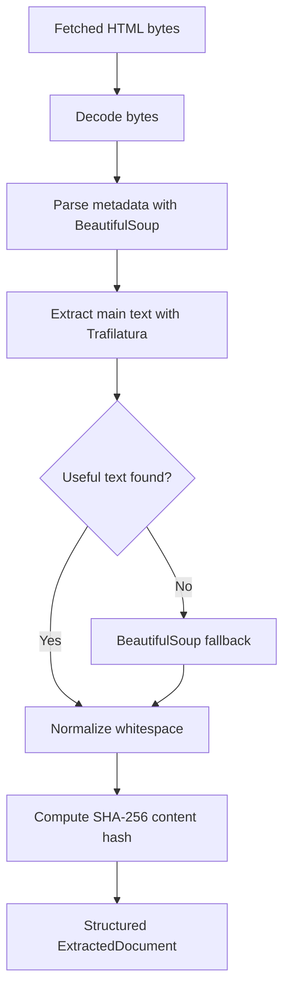

# 05 — HTML Content Extraction

## 1. Why extraction matters

The HTTP fetcher returns the bytes of a web response. Those bytes are usually HTML, not a clean article.

A page may contain:
- Navigation and menus.
- Headers and footers.
- Advertisements and related-content panels.
- JavaScript and CSS.
- Cookie notices and forms.
- The main article or documentation content.

If we index the entire page indiscriminately, common navigation phrases can appear in thousands of documents and reduce retrieval quality. Extraction tries to isolate the meaningful page content.

## 2. Tools and responsibilities

### BeautifulSoup

BeautifulSoup parses HTML into a tree that Python code can inspect.

We use it for:
- Page title.
- Meta description.
- Canonical link.
- HTML language attribute.
- Removing obvious non-content elements.
- A fallback text extraction path.

BeautifulSoup is a parser and tree-navigation library. It is not, by itself, a sophisticated main-article extraction algorithm.

### Trafilatura

Trafilatura uses extraction heuristics to identify the main readable content of web pages. It is our primary extraction tool.

It is not perfect. Different page layouts, documentation sites, and JavaScript-generated pages can produce incomplete results. We preserve the extraction method and should monitor empty or suspiciously short outputs.

## 3. Extraction pipeline



## 4. Metadata fields

The initial ExtractedDocument contains:

| Field | Meaning |
|---|---|
| source_url | URL we actually fetched |
| canonical_url | Canonical URL declared by the page, if valid HTTP(S) |
| title | Page title |
| description | Meta description |
| language | Language tag from the HTML element |
| text | Extracted main text |
| content_hash | SHA-256 hash of normalized extracted text |
| extractor | Which extraction path produced the text |

The canonical URL is metadata, not permission to crawl another host. If a page declares a canonical URL on a different domain, the crawler must not automatically follow it.

## 5. Why content hashes?

A content hash gives us a compact way to detect identical extracted text.

For example, two different URLs may return the same article. If their normalized text hashes match, they are exact text duplicates.

A hash is not a near-duplicate detector. Minor changes in whitespace or punctuation can change the hash. Later we can consider similarity hashes or shingling for near-duplicate detection.

Do not use the content hash as the only document identity. Keep URL identity, page metadata, and crawl history too.

## 6. Whitespace normalization

HTML text often contains repeated spaces and line breaks. We collapse runs of whitespace into a single space.

We intentionally avoid aggressive transformations such as:
- Removing punctuation.
- Lowercasing all content.
- Removing every short word.
- Rewriting code examples.

Those transformations can damage technical documentation, code identifiers, error messages, and headings. Search-specific tokenization belongs in the indexing layer.

## 7. Install dependencies

The project dependencies include:
- `beautifulsoup4` — HTML tree parsing.
- `lxml` — fast HTML parser backend.
- `trafilatura` — main content extraction.

Install all project requirements:

```bash
python -m pip install -r requirements.txt
```

Run tests:

```bash
python -m pytest -q
```

## 8. Example usage

```python
from app.extraction.html_extractor import extract_html

html = """
<html lang="en">
<head>
  <title>Python Asyncio Guide</title>
  <meta name="description" content="Learn asynchronous Python.">
</head>
<body>
  <nav>Navigation</nav>
  <main>
    <article>
      <h1>Asyncio</h1>
      <p>Asyncio provides infrastructure for writing concurrent code.</p>
    </article>
  </main>
  <footer>Copyright</footer>
</body>
</html>
"""

document = extract_html(
    html,
    "https://docs.example.org/asyncio",
)

print(document.title)
print(document.description)
print(document.text)
print(document.content_hash)
```

## 9. Failure handling and quality checks

Extraction should not silently turn a bad page into a good document.

Record:
- Extraction success or failure.
- Extractor name and version.
- Extracted character count.
- Content hash.
- Fetch timestamp.
- Source URL and final URL.
- Failure reason, if any.

Potential quality checks:
- Empty text.
- Very short text.
- Text that is mostly repeated boilerplate.
- Unexpected language.
- Content hash identical to many unrelated URLs.

A short page is not automatically invalid. A concise API reference page may be useful. Treat thresholds as monitoring signals, not universal deletion rules.

## 10. Important limitations

- Trafilatura cannot reliably extract content that is rendered only after complex JavaScript execution.
- Some pages block automated clients or require authentication; do not bypass those restrictions.
- Metadata can be missing or misleading.
- Canonical links are publisher-provided hints, not trusted crawl instructions.
- The extractor does not decide whether the source is authoritative or factually correct.

## 11. Practical exercise

1. Extract a small HTML page with navigation and an article.
2. Compare the raw HTML text with the extracted text.
3. Change only the page title and verify that the content hash stays the same.
4. Change the article paragraph and verify that the hash changes.
5. Add a canonical URL pointing to another domain. Confirm it is recorded as metadata but is not automatically crawled.

## 12. Completion criteria

You should be able to explain the difference between parsing HTML and extracting its main content, identify why canonical URLs are untrusted hints, and explain how content hashes support deduplication.

Next: persist extracted documents and build a PostgreSQL schema that supports recrawls, document versions, and indexing.
